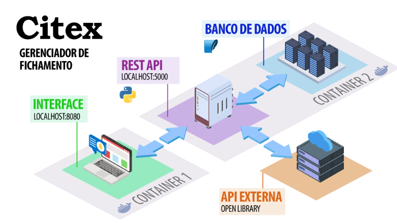

# CITEX | Front end

> Projeto criado como parte das exigências para a conclusão do sprint Back End Avançado da pós-graduação em **Especialização em Desenvolvimento Full Stack** da **PUC Rio**.

**Citex** é um app simples de fichamento de livros, em formato *Single Page Application*. Consiste em um *front end* criado em HTML, CSS (componentes Bootstrap) e Javascript, alimentado por um *back end* com uma API em Python e um banco de dados em SQLite. 

A API também consome dados da API externa [Open Library](https://openlibrary.org/dev/docs/api/books). É uma iniciativa sem fins lucrativos do [Internet Archive](https://archive.org/) que fornece um catálogo de informações bibliográficas abertas e de domínio público. Não são exigidos tokens, chaves ou licenças para operações de leitura.

> **Este repositório contém apenas o *front end* da aplicação.**
> O *back end* está publicado e explicado [neste repositório](https://github.com/he-pl/citex-backend).

## ARQUITETURA



## VISÃO GERAL

O *front end* de **Citex** está organizado da seguinte forma:

### INÍCIO
Página inicial com menu para navegação (Início | Livros). Quando o banco de dados ja está populado, exibe o ultimo livro editado.

### LIVROS
Possui um formulário para inserção de novo livro no banco de dados. O primeiro campo, ISBN, tem um botão que faz uma busca nos dados da [Open Library](https://openlibrary.org/dev/docs/api/books) para popular automaticamente os campos. Os dados também podem ser alimentados manualmente.

Abaixo do formulário, é exibida a lista de livros que já constam no banco de dados

A tabela tem as colunas:
**Título**, que é clicável e direciona para a página individual do livro;
**Autor**;
**Editora**
**Ano**
**Ações**, com botões **editar** (que leva de volta ao formulário) e **deletar** (que deleta aquele livro e suas citações)

### PÁGINA INDIVIDUAL DO LIVRO
Exibe um card com os dados do livro, um formulário para adicionar citações, e a lista 

## POSSIBILIDADES
Algumas mudanças no aplicativo cogitadas para o futuro:

***UI***
- Ajustar para um design mais relacionado a livros

***Cadastro de usuários***
- Tabela de usuários e implementação de autenticação e permissões

***Projetos***
- Funcionalidade para vincular livros e citações a projetos específicos (como um artigo, uma tese, uma resenha). Autor poderá convidar outros usuários para o projeto (como co-autores ou orientador), com prerrogativa de adicionar livros e citações.

***Livros***
- Armazenar imagem da capa (busca via ISBN em outra API externa da Open Library, "Covers". Opção de baixar imagem de um link, ou upload da imagem, ou arrastar arquivo para a UI).
- controles no cabeçalho da tabela de livros, para filtragem e ordenação.
- exibir as entradas da tabela como cartões, com imagem da capa e layout mais amigável.


## COMO EXECUTAR
Fazer o download do projeto e abrir o arquivo index.html no seu browser.

## COMO EXECUTAR FRONTEND VIA DOCKER

**1. Necessário ter o Docker instalado.** Disponível [aqui](https://docs.docker.com/engine/install/).

**2. Clonar o repositório.** 

**3. Acesse a raiz da pasta e crie a imagem Docker.** Entre em citex-frontend e use este comando:
```
 docker build -t citex-frontend .
```

**4. Rode o container.** Ainda em citex-frontend, execute o seguinte comando:
```
 docker run -d --name nginx_frontend -p 8080:80 citex-frontend
```
Depois de ativado, a UI do app estará disponível em http://localhost:8080.

>Obs.: Sem o [back-end](https://github.com/he-pl/citex-backend) rodando simultaneamente na porta 5000, a interface ficará incompleta e sem dados. Para instalar os dois simultaneamente, siga a seção abaixo.

## COMO EXECUTAR O O APP INTEIRO VIA DOCKER

**1. Necessário ter o Docker instalado.** Disponível [aqui](https://docs.docker.com/engine/install/).

**2. Clonar este repositório e o de [back-end](https://github.com/he-pl/citex-backend).** Salve-os na mesma pasta e mantenha os nomes dos repositorios. 

Após clonar os repositórios, o arquivo docker-compose.yml estará na pasta "citex-frontend". Para que ele funcione:
- ele deve ser ativado a partir desta pasta
- as pastas "citex-frontend" e "citex-backend" devem estar num diretório comum

**3. Acesse a raiz da pasta "citex-frontend" e rode docker-compose.** Use este comando:
```
docker-compose up --build
```
Ativados os dois containers: 
- UI do app: http://localhost:8080.
- API do backend: http://localhost:5000/api/livros
- Documentação Swagger das rotas: http://localhost:5000/apidocs/